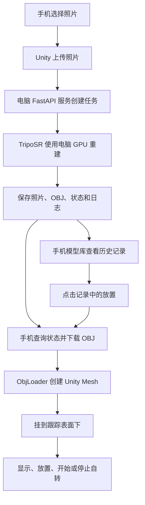

# PhotoAR App 全流程与代码说明

> 文档日期：2026-10-03。依据当前项目实际源码整理，包含已实现内容、实际测试结果和未完成部分。
>
> 阅读顺序：先看“总览”，再按六个模块阅读。每段代码均附源文件与行号；代码片段来自当前源码。以后修改源码后，行号可能变化，可按函数名搜索。

## 目录

1. [总览：手机、电脑和 Unity 分别做什么](#1-总览手机电脑和-unity-分别做什么)
2. [模块一：手机界面与照片输入](#2-模块一手机界面与照片输入)
3. [模块二：电脑服务与 TripoSR 生成](#3-模块二电脑服务与-triposr-生成)
4. [模块三：模型保存与历史模型库](#4-模块三模型保存与历史模型库)
5. [模块四：Unity 模型加载与通用操作](#5-模块四unity-模型加载与通用操作)
6. [模块五：AR 跟踪与放置](#6-模块五ar-跟踪与放置)
7. [模块六：打包、图标与独立测试](#7-模块六打包图标与独立测试)
8. [一次完整操作与排错](#8-一次完整操作与排错)
9. [修改功能时应该改哪里](#9-修改功能时应该改哪里)
10. [文件位置总索引](#10-文件位置总索引)

## 1. 总览：手机、电脑和 Unity 分别做什么

**手机负责选择照片、显示界面和 AR；电脑负责调用 TripoSR 生成并保存模型；Unity 把下载的模型转换成可操作的场景对象。**

### 1.1 两条使用流程



| 场景 | 是否需要重新运行 TripoSR | 手机最后做什么 |
|---|---|---|
| 选择新照片生成 | 需要 | 下载新模型，替换当前对象 |
| 模型库选择旧模型 | 不需要 | 下载已保存 OBJ，替换当前对象 |

两条流程最终汇合到 `EasyARSurfaceApp.Load()`，因此模型加载、自转和放置逻辑可以复用。

### 1.2 六个主要模块

| 模块 | 职责 | 主要输入 | 主要输出 |
|---|---|---|---|
| 一、界面与照片 | 按钮、状态、照片选择、模型库面板 | 用户点击、照片 | 照片字节、操作请求 |
| 二、生成服务 | HTTP、任务排队、调用 TripoSR | 照片字节 | 任务状态、OBJ |
| 三、保存与模型库 | 保存历史任务、列表、缩略图和下载 | 成功任务目录 | 历史模型列表和文件 |
| 四、Unity 模型 | 解析 OBJ、创建 Mesh、统一模型结构、自转 | OBJ 文本 | Unity GameObject |
| 五、AR | 相机、环境跟踪、放置关系 | 相机和传感器数据 | 跟踪目标与模型位置关系 |
| 六、构建与测试 | Android 配置、图标、APK、独立验证 | 工程和本地授权配置 | APK、诊断和测试报告 |

### 1.3 当前实际版本与原始要求

当前 AAK-AN00（荣耀 WIN RT）手机版运行 **EasyAR 表面跟踪**。Google ARCore 的原生 Session 构造在该手机上返回 `UnavailableDeviceNotCompatibleException`，因此当前手机版没有使用 ARCore 完成平面跟踪。

原始 AR Foundation 分支仍保留在工程中，包含“选择相机画面中投影面积最大的平面 → 计算中心 → 创建真实 AR 锚点”的代码和模拟测试。**不能把当前 EasyAR 的“重新放置到画面中央”称为已经完成原始最大平面中心锚定。**

EasyAR 表面跟踪可以使用环境特征跟踪，但不提供平面检测或真实尺度；特征丢失或环境变化时可能漂移。当前模型大小为逻辑空间中的统一大小，不能保证对应现实中的精确厘米。

### 1.4 本机环境与根目录

| 项目 | 本机位置/配置 |
|---|---|
| 工程总目录 | `C:\Users\19554\Documents\Codex\2026-10-02\wode\outputs\PhotoAR` |
| Unity 源工程 | `C:\Users\19554\Documents\Codex\2026-10-02\wode\outputs\PhotoAR\Unity` |
| 电脑服务 | `C:\Users\19554\Documents\Codex\2026-10-02\wode\outputs\PhotoAR\backend` |
| TripoSR 原仓库 | `E:\PROJECT_my_python\TripoSR` |
| TripoSR Python | `E:\conda-envs\triposr311\python.exe` |
| Unity | `E:\Unity\6000.3.19f1\Editor\Unity.exe` |
| Android 包名 | `com.photoar.local` |
| 默认服务地址 | `http://127.0.0.1:8090` |
| 当前连接方式 | USB 端口映射，未配置内网穿透 |

手机访问 `127.0.0.1:8090` 能连接电脑，是因为已通过 ADB 将手机该端口转发到电脑。离开 USB 后，这个地址不会自动变成电脑地址。

## 2. 模块一：手机界面与照片输入

### 2.1 用户看到什么

- 顶部：PhotoAR 品牌和“表面已跟踪/缓慢移动手机”。
- 底部创作台：当前模型、自转状态、模型库、重新放置、开始/停止自转。
- 照片区域：照片缩略图、“选择照片”和“生成并放置”。
- 模型库：历史模型缩略图、生成时间、文件大小、刷新与放置。
- 独立测试：旋转检查、重新加载示例、模型库连接检查。

界面由 `PhotoARMobileUI` 运行时创建 Canvas、文字、按钮和滚动列表。它通过调用控制器方法触发工作，不直接运行 TripoSR，也不直接计算 AR 相机姿态。

### 2.2 照片怎样从 Android 进入 Unity

1. “选择照片”按钮调用 `EasyARSurfaceApp.ChoosePhoto()`。
2. C# 调用 Java 的 `Gallery.pick("PhotoAR")`。
3. Java 用 Android 系统文件选择器打开图片。
4. 选择器返回的是 `Uri`，Java 用系统流读取，将文件复制到 App 缓存。
5. Java 向名为 `PhotoAR` 的 Unity 对象发送 `OnPhotoSelected` 消息。
6. Unity 读取缓存文件得到 `byte[] photo`，刷新照片预览。

这一步只选择照片，没有开始重建。生成按钮是独立操作。

[EasyARSurfaceApp.cs 第 67 行](C:/Users/19554/Documents/Codex/2026-10-02/wode/outputs/PhotoAR/Unity/Assets/PhotoAR/Runtime/EasyARSurfaceApp.cs:67)

```csharp
    public void ChoosePhoto(){
#if UNITY_ANDROID && !UNITY_EDITOR
        using(var gallery=new AndroidJavaClass("com.photoar.Gallery"))gallery.CallStatic("pick","PhotoAR");
#endif
    }
```

[Gallery.java 第 28 行](C:/Users/19554/Documents/Codex/2026-10-02/wode/outputs/PhotoAR/Unity/Assets/Plugins/Android/Gallery.java:28)

```java
            Intent intent=new Intent(Intent.ACTION_OPEN_DOCUMENT);intent.setType("image/*");intent.addCategory(Intent.CATEGORY_OPENABLE);
            startActivityForResult(intent,91);
        }
```

[Gallery.java 第 41 行](C:/Users/19554/Documents/Codex/2026-10-02/wode/outputs/PhotoAR/Unity/Assets/Plugins/Android/Gallery.java:41)

```java
            UnityPlayer.UnitySendMessage(target,"OnPhotoSelected",out.getAbsolutePath());
```

[EasyARSurfaceApp.cs 第 79 行](C:/Users/19554/Documents/Codex/2026-10-02/wode/outputs/PhotoAR/Unity/Assets/PhotoAR/Runtime/EasyARSurfaceApp.cs:79)

```csharp
    public void OnPhotoSelected(string path){try{photo=File.ReadAllBytes(path);status="照片已选好，点击生成并放置";mobileUI?.RefreshPhoto();}catch(Exception e){status=e.Message;}}
```

### 2.3 界面按钮与业务方法的对应关系

| 按钮 | 控制器入口 | 实际效果 |
|---|---|---|
| 选择照片 | `ChoosePhoto()` | 打开 Android 图片选择器 |
| 生成并放置 | `Generate()` | 上传、查询、下载，然后加载 |
| 模型库 | `PhotoARMobileUI.OpenLibrary()` | 显示历史记录 |
| 模型库中的放置 | `SelectSavedModel()` | 下载所选 OBJ，切换显示对象 |
| 重新放置 | `Realign()` | 将表面跟踪点对准画面中央 |
| 开始/停止自转 | `SetRotation(true/false)` | 改变 Spin 的运行状态 |
| 独立测试 | `OpenTests()` | 打开测试操作面板 |

生成/加载期间使用 `busy` 状态防止重复提交；界面依据 `Busy` 和 `HasPhoto` 更新按钮状态。

### 2.4 模块边界

`PhotoARMobileUI` 负责表现，`EasyARSurfaceApp` 负责流程编排，`Gallery.java` 负责 Android 原生照片访问。修改按钮颜色和排版时，不需要修改生成算法。

界面初始化入口：[PhotoARMobileUI.cs 第 15 行](C:/Users/19554/Documents/Codex/2026-10-02/wode/outputs/PhotoAR/Unity/Assets/PhotoAR/Runtime/PhotoARMobileUI.cs:15)。模型库界面入口：[PhotoARMobileUI.cs 第 54 行](C:/Users/19554/Documents/Codex/2026-10-02/wode/outputs/PhotoAR/Unity/Assets/PhotoAR/Runtime/PhotoARMobileUI.cs:54)。

## 3. 模块二：电脑服务与 TripoSR 生成

### 3.1 一个异步任务怎样执行

1. 手机 `GenerationClient.Generate()` 向 `POST /jobs` 发送 multipart 表单，字段名为 `photo`。
2. 服务检查照片：最大12 MB，最大2400万像素，处理 EXIF 方向。
3. 创建 UUID 任务目录，保存标准化的 `input.png`。
4. 返回任务 ID；GPU 工作由后台线程执行，HTTP 请求不一直等到重建结束。
5. 手机每隔约1秒查询 `GET /jobs/{id}`。
6. 成功后从 `GET /jobs/{id}/model` 下载 OBJ。
7. 客户端把 OBJ 文本交给 `Load()`。

状态顺序为 `queued → running → succeeded`，失败则为 `failed`。当前单 GPU 工作线程一次处理一个生成任务；队列过长时拒绝新增请求，避免同时启动多个重建进程抢显存。

[GenerationClient.cs 第 9 行](C:/Users/19554/Documents/Codex/2026-10-02/wode/outputs/PhotoAR/Unity/Assets/PhotoAR/Runtime/GenerationClient.cs:9)

```csharp
    public IEnumerator Generate(byte[] photo,Action<string> progress,Action<string> complete,Action<string> fail) {
        var form=new WWWForm();form.AddBinaryData("photo",photo,"photo.png","image/png");
        Job job;
        using(var req=UnityWebRequest.Post(baseUrl.TrimEnd('/')+"/jobs",form)) {
            req.timeout=30;yield return req.SendWebRequest();
            if(req.result!=UnityWebRequest.Result.Success){fail(req.error+" "+req.downloadHandler.text);yield break;}
            job=JsonUtility.FromJson<Job>(req.downloadHandler.text);
        }
        float deadline=Time.realtimeSinceStartup+660;
        while(job.state!="succeeded") {
            if(job.state=="failed"){fail(job.error);yield break;}
            if(Time.realtimeSinceStartup>deadline){fail("Generation timed out");yield break;}
            progress(job.state);yield return new WaitForSecondsRealtime(1);
            using(var req=UnityWebRequest.Get(baseUrl.TrimEnd('/')+"/jobs/"+job.id)) {
                req.timeout=15;yield return req.SendWebRequest();
                if(req.result!=UnityWebRequest.Result.Success){fail(req.error);yield break;}
                job=JsonUtility.FromJson<Job>(req.downloadHandler.text);
            }
        }
        using(var req=UnityWebRequest.Get(baseUrl.TrimEnd('/')+job.model_url)) {
            req.timeout=60;yield return req.SendWebRequest();
            if(req.result!=UnityWebRequest.Result.Success){fail(req.error);yield break;}
            complete(req.downloadHandler.text);
        }
    }
```

上面的轮询代码会继续请求任务状态；成功后下载模型。客户端生成总等待约660秒，后端 TripoSR 子进程限制600秒。

### 3.2 服务怎样调用模型生成器

[service.py 第 29 行](C:/Users/19554/Documents/Codex/2026-10-02/wode/outputs/PhotoAR/backend/service.py:29)

```python
def reconstruct(jid):
    folder = DATA / jid
    try:
        write_state(jid, state='running')
        mesh = generator.generate(folder/'input.png',folder/'output',folder/'inference.log')
        if not mesh.is_file() or mesh.stat().st_size == 0:
            raise RuntimeError('Reconstruction returned no mesh')
        write_state(jid, state='succeeded', model_url=f'/jobs/{jid}/model', error=None)
    except Exception as exc:
        write_state(jid, state='failed', error=str(exc))

```

### 3.3 为什么把 TripoSR 放在独立适配器中

HTTP 服务只调用统一接口 `generator.generate(photo, output, log)`。生成器可以替换为：

- `MockGenerator`：快速输出小网格，测试 HTTP 与 Unity 流程，不使用 GPU。
- `TripoSRGenerator`：启动本机 TripoSR 的 `run.py`，执行真实重建。

所以模拟测试不必等待真实生成，换重建算法时也不用重写手机界面和 HTTP 接口。

[adapters.py 第 7 行](C:/Users/19554/Documents/Codex/2026-10-02/wode/outputs/PhotoAR/backend/adapters.py:7)

```python
class MeshGenerator(Protocol):
    def generate(self, photo: Path, output: Path, log: Path) -> Path: ...

```

[adapters.py 第 11 行](C:/Users/19554/Documents/Codex/2026-10-02/wode/outputs/PhotoAR/backend/adapters.py:11)

```python
    def generate(self, photo, output, log):
        mesh=output/'0'/'mesh.obj';mesh.parent.mkdir(parents=True,exist_ok=True)
        mesh.write_text('v -1 0 -1 1 0 0\nv 1 0 -1 0 1 0\nv 0 2 0 0 0 1\nf 1 2 3\nf 3 2 1\n')
        return mesh

```

[adapters.py 第 16 行](C:/Users/19554/Documents/Codex/2026-10-02/wode/outputs/PhotoAR/backend/adapters.py:16)

```python
class TripoSRGenerator:
    def __init__(self, repo: Path, python: str, cache: Path, resolution=128):
        self.repo,self.python,self.cache,self.resolution=repo,python,cache,resolution
    def generate(self, photo, output, log):
        self.cache.mkdir(parents=True,exist_ok=True)
        env=dict(os.environ,HF_HUB_OFFLINE='1',HF_HUB_DISABLE_SYMLINKS_WARNING='1',
                 NUMBA_CACHE_DIR=str(self.cache),PYTHONDONTWRITEBYTECODE='1')
        with log.open('w',encoding='utf-8') as stream:
            subprocess.run([self.python,str(self.repo/'run.py'),str(photo),
                '--output-dir',str(output),'--model-save-format','obj',
                '--mc-resolution',str(self.resolution)],cwd=self.repo,env=env,
                stdout=stream,stderr=subprocess.STDOUT,check=True,timeout=600)
        return output/'0'/'mesh.obj'
```

真实适配器使用 `--model-save-format obj` 和当前默认 `--mc-resolution 128`。推理日志写入任务目录，Numba 缓存放在服务数据目录中；没有修改原 TripoSR 仓库。

### 3.4 这一步的输入与输出

| 输入 | 处理 | 输出 |
|---|---|---|
| 一张照片 | TripoSR 单图三维重建 | 静态网格 OBJ 与颜色 |

生成结果不是带骨骼的角色动画。质量受到照片清晰度、遮挡、背景及重建模型能力影响。自转来自 Unity 脚本，不是 TripoSR 生成的动画。

## 4. 模块三：模型保存与历史模型库

### 4.1 模型保存在哪里

电脑持久保存根目录：

```text
C:\Users\19554\Documents\Codex\2026-10-02\wode\outputs\PhotoAR\backend\data
```

每次生成单独保存：

```text
data/
├── <任务 UUID>/
│   ├── input.png           用于生成的照片
│   ├── status.json         状态、任务 ID、模型下载地址或错误
│   ├── inference.log       TripoSR 日志
│   └── output/
│       └── 0/
│           └── mesh.obj    可下载和再次加载的模型
└── numba-cache/            推理缓存，不是模型记录
```

更换手机当前模型只移除 Unity 场景中的旧对象，不删除电脑上的模型文件。App 界面目前也没有删除电脑模型的功能。

### 4.2 历史列表怎样生成

服务的 `GET /models` 扫描 UUID 任务目录，从磁盘读取状态，只返回“任务成功且 mesh.obj 存在”的记录，按文件生成时间倒序排列。

模型列表不是只存在服务内存里，因此电脑服务重启后，成功生成的文件仍可以进入模型库。

[service.py 第 89 行](C:/Users/19554/Documents/Codex/2026-10-02/wode/outputs/PhotoAR/backend/service.py:89)

```python
def list_models():
    """Persisted successful results; independent of worker state or service restarts."""
    results=[]
    for folder in DATA.iterdir():
        if not folder.is_dir(): continue
        try:
            uuid.UUID(folder.name)
            state=get_job(folder.name)
            mesh=folder/'output'/'0'/'mesh.obj'
            if state['state']!='succeeded' or not mesh.is_file(): continue
            created=mesh.stat().st_mtime
            results.append({'id':folder.name,'name':'模型 · '+datetime.fromtimestamp(created).strftime('%m-%d %H:%M'),
                'created':created,'bytes':mesh.stat().st_size,'model_url':f'/jobs/{folder.name}/model',
                'thumbnail_url':f'/jobs/{folder.name}/thumbnail'})
        except (ValueError,KeyError,OSError,json.JSONDecodeError,HTTPException): continue
    return {'models':sorted(results,key=lambda m:m['created'],reverse=True)}

```

每条记录包含：`id`、显示名称、生成时间、文件大小、模型下载地址、缩略图地址。显示名称目前按生成时间自动命名，没有识别照片里的物体名称，也没有重命名界面。

缩略图来自原输入照片，经后端缩到最长边240像素后返回 JPEG。**模型库小图是照片缩略图，不是三维模型渲染图。**

### 4.3 手机怎样取列表并切换模型

`ModelLibraryClient` 分为三个独立操作：

| 方法 | 功能 |
|---|---|
| `List()` | 获取模型列表 |
| `Thumbnail()` | 下载照片缩略图 |
| `Load()` | 下载某个历史模型的 OBJ |

[ModelLibraryClient.cs 第 10 行](C:/Users/19554/Documents/Codex/2026-10-02/wode/outputs/PhotoAR/Unity/Assets/PhotoAR/Runtime/ModelLibraryClient.cs:10)

```csharp
    public IEnumerator List(Action<SavedModel[]> complete,Action<string> fail){
        using(var r=UnityWebRequest.Get(baseUrl+"/models")){r.timeout=15;yield return r.SendWebRequest();
            if(r.result!=UnityWebRequest.Result.Success){fail("无法连接模型库，请检查电脑服务和 USB 连接。");yield break;}
            SavedModels data=null;try{data=JsonUtility.FromJson<SavedModels>(r.downloadHandler.text);}catch(Exception){}
            if(data==null){fail("模型库返回的数据无法读取。");yield break;}complete(data.models??Array.Empty<SavedModel>());
        }
    }
```

[ModelLibraryClient.cs 第 17 行](C:/Users/19554/Documents/Codex/2026-10-02/wode/outputs/PhotoAR/Unity/Assets/PhotoAR/Runtime/ModelLibraryClient.cs:17)

```csharp
    public IEnumerator Load(SavedModel item,Action<string> complete,Action<string> fail){
        using(var r=UnityWebRequest.Get(baseUrl+item.model_url)){r.timeout=60;yield return r.SendWebRequest();if(r.result!=UnityWebRequest.Result.Success){fail("模型加载失败，请检查电脑连接后重试。");yield break;}complete(r.downloadHandler.text);}
    }
```

[EasyARSurfaceApp.cs 第 74 行](C:/Users/19554/Documents/Codex/2026-10-02/wode/outputs/PhotoAR/Unity/Assets/PhotoAR/Runtime/EasyARSurfaceApp.cs:74)

```csharp
    public void SelectSavedModel(SavedModel item,Action done,Action<string> failed){
        if(busy)return;busy=true;status="正在加载已保存的模型…";
        StartCoroutine(new ModelLibraryClient().Load(item,text=>{busy=false;Load(text);CurrentModelName=item.name;Realign();done();},error=>{busy=false;status=error;failed(error);}));
    }
```

选择成功后会：下载 OBJ → 创建新 Unity 模型 → 更新当前模型名称 → 重新对准屏幕中央 → 关闭模型库。

### 4.4 API 对照表

| 方法与地址 | 用途 | 使用模块 |
|---|---|---|
| `GET /health` | 服务检查 | 调试与测试 |
| `POST /jobs` | 上传照片、新建生成任务 | GenerationClient |
| `GET /jobs/{id}` | 查询任务进度 | GenerationClient |
| `GET /jobs/{id}/model` | 下载 OBJ | 生成客户端与模型库客户端 |
| `GET /models` | 获取成功模型列表 | ModelLibraryClient |
| `GET /jobs/{id}/thumbnail` | 获取照片缩略图 | 模型库界面 |

列表与下载默认依赖电脑服务，当前没有完整的手机离线模型库。

## 5. 模块四：Unity 模型加载与通用操作

### 5.1 核心：不同模型用同一套结构

OBJ 文件的数据不同，但 Unity 创建出的对象结构一致：

```text
SurfaceTarget                    表面跟踪目标
└── SurfaceRotatingModel          当前模型根对象
    ├── Spin                     自转脚本
    └── Mesh                     实际几何对象
        ├── MeshFilter           顶点、三角形组成的网格
        └── MeshRenderer         材质、顶点颜色与绘制
```

`EasyARSurfaceApp.model` 保存当前模型对象的引用。切换模型时，后续所有操作就作用到新对象，因此不必为每个 OBJ 文件重新编写脚本。

### 5.2 OBJ 解析：文件文本变成 Unity Mesh

`ObjLoader.ParseData()` 读取 `v` 顶点和 `f` 面，支持负索引和多边形三角化。它将 TripoSR 的 Z 向上坐标转换为 Unity 的 Y 向上坐标，并反转三角形绕序。

[ObjLoader.cs 第 19 行](C:/Users/19554/Documents/Codex/2026-10-02/wode/outputs/PhotoAR/Unity/Assets/PhotoAR/Runtime/ObjLoader.cs:19)

```csharp
                // TripoSR Z-up right-handed -> Unity Y-up left-handed.
                v.Add(new Vector3(F(t[1]),F(t[3]),F(t[2])));
                c.Add(t.Length>=7?new Color(F(t[4]),F(t[5]),F(t[6]),1):Color.gray);
```

[ObjLoader.cs 第 34 行](C:/Users/19554/Documents/Codex/2026-10-02/wode/outputs/PhotoAR/Unity/Assets/PhotoAR/Runtime/ObjLoader.cs:34)

```csharp
    public static Mesh Parse(string text) {
        var data=ParseData(text);
        var mesh=new Mesh {indexFormat=IndexFormat.UInt32};mesh.SetVertices(data.vertices);mesh.SetColors(data.colors);mesh.SetTriangles(data.triangles,0);mesh.RecalculateNormals();mesh.RecalculateBounds();return mesh;
    }
```

### 5.3 统一尺寸与底部中心

不同模型可能数值大小不同。加载器取包围盒最长边，把显示尺寸归一化到0.3个 Unity 逻辑单位，并将底面中心移动到根对象原点。

这样每个模型更换后，都能使用相同的放置点和自转轴。当前 EasyAR 表面跟踪没有真实尺度，因此0.3逻辑单位不等于已校准的现实30厘米。

[ObjLoader.cs 第 38 行](C:/Users/19554/Documents/Codex/2026-10-02/wode/outputs/PhotoAR/Unity/Assets/PhotoAR/Runtime/ObjLoader.cs:38)

```csharp
    public static GameObject Create(string text,float meters) {
        var mesh=Parse(text);var b=mesh.bounds;
        float size=Mathf.Max(b.size.x,Mathf.Max(b.size.y,b.size.z));if(size<1e-6)throw new FormatException("Zero size mesh");
        var root=new GameObject("RotatingModel");var child=new GameObject("Mesh");child.transform.SetParent(root.transform,false);
        child.AddComponent<MeshFilter>().sharedMesh=mesh;
        var shader=Shader.Find("PhotoAR/VertexColor");if(!shader)throw new InvalidOperationException("Vertex color shader missing");
        child.AddComponent<MeshRenderer>().sharedMaterial=new Material(shader);
        child.transform.localScale=Vector3.one*(meters/size);
        child.transform.localPosition=-new Vector3(b.center.x,b.min.y,b.center.z)*(meters/size);
        root.AddComponent<Spin>();return root;
    }
}
```

### 5.4 替换当前对象并挂到跟踪目标

[EasyARSurfaceApp.cs 第 45 行](C:/Users/19554/Documents/Codex/2026-10-02/wode/outputs/PhotoAR/Unity/Assets/PhotoAR/Runtime/EasyARSurfaceApp.cs:45)

```csharp
    void Load(string obj){try{var next=ObjLoader.Create(obj,.3f);if(model)Destroy(model);model=next;model.name="SurfaceRotatingModel";model.transform.SetParent(target.transform,false);model.GetComponent<Spin>().degreesPerSecond=60;SetRotation(true);status="模型已就绪，可重新放置或从模型库切换";}catch(Exception e){status=e.Message;}}
```

这段函数较紧凑，按执行顺序读即可：

1. `ObjLoader.Create()` 先创建新对象。
2. `Destroy(model)` 移除旧显示对象；电脑文件不受影响。
3. `model = next` 更新“当前模型”的引用。
4. `SetParent(target.transform, false)` 将新模型挂到跟踪目标下，使用局部坐标。
5. 给当前模型设置60度/秒，并开启自转。

### 5.5 自转为什么能应用到所有模型

`Spin` 只使用 Transform，不依赖物体名称、网格形状或任务 ID。下面是实际脚本：

[ObjLoader.cs 第 50 行](C:/Users/19554/Documents/Codex/2026-10-02/wode/outputs/PhotoAR/Unity/Assets/PhotoAR/Runtime/ObjLoader.cs:50)

```csharp
public class Spin:MonoBehaviour {
    public float degreesPerSecond=30;public bool running=true;
    public void Step(float delta) {if(running)transform.Rotate(Vector3.up,degreesPerSecond*delta,Space.Self);}
    void Update()=>Step(Time.deltaTime);
}
}
```

[EasyARSurfaceApp.cs 第 46 行](C:/Users/19554/Documents/Codex/2026-10-02/wode/outputs/PhotoAR/Unity/Assets/PhotoAR/Runtime/EasyARSurfaceApp.cs:46)

```csharp
    public void SetRotation(bool enabled){if(model)model.GetComponent<Spin>().running=enabled;}
```

`Spin` 的默认速度是30度/秒；当前 EasyAR App 加载模型后显式覆盖为60度/秒。它旋转模型根对象的局部 Y 轴，不旋转 SurfaceTarget，因此放置关系与动画控制分开。

跟踪丢失时，SDK 可能临时隐藏目标对象；父对象不活跃时，子对象的 Update 也不会执行。这与手动停止自转是不同情况，诊断中分别记录 `modelActive` 和 `rotationRunning`。

### 5.6 颜色怎样显示

当前模型使用顶点颜色。`ObjLoader` 将颜色写入 Mesh，`PhotoAR/VertexColor` Shader 根据顶点颜色和简单光照显示。当前加载器没有完整读取 OBJ 的 MTL、UV 贴图等材质流程。

材质代码：[VertexColor.shader 第 1 行](C:/Users/19554/Documents/Codex/2026-10-02/wode/outputs/PhotoAR/Unity/Assets/PhotoAR/Runtime/VertexColor.shader:1)。

### 5.7 想对不同模型增加更多 Unity 操作

当前已实现：加载、替换、重新定位、统一尺寸、开始/停止自转。拖拽、双指缩放、手势旋转和每模型独立参数的界面尚未实现。

下面是二次开发示意，**不是当前已有的 UI 功能**：

```csharp
// 修改当前模型的大小；保留底部原点作为缩放中心。
model.transform.localScale = Vector3.one * 1.5f;

// 修改当前模型的局部朝向。
model.transform.localRotation = Quaternion.Euler(0, 90, 0);

// 给当前模型设置自己的自转速度。
model.GetComponent<Spin>().degreesPerSecond = 20f;
```

如果需要不同模型使用不同规则，建议以任务 ID 作为稳定标识，新增 `ModelProfile` 保存缩放、朝向、自转速度和是否允许自转，在 `Load()` 后应用。不要按“模型A、模型B”硬编码不同脚本，也不要用会重复的生成时间名称作为唯一 ID。

## 6. 模块五：AR 跟踪与放置

### 6.1 当前手机路径：EasyAR Surface Tracking

Android 后摄像头提供实时画面，EasyAR 使用图像特征与惯性信息跟踪环境表面。模型挂在 SurfaceTarget 下，相机与目标间的关系由 SDK 更新，形成手机移动时的 AR 效果。

`EasyARBuild` 使用 SDK 官方 SurfaceTracking 示例的相机/会话配置，移除示例界面与模型，替换为自己的控制器和模型。当前表面跟踪路径不要求 ARCore 会话成功。

构建时将 XR 自动启动关闭，避免同时启动 ARCore 抢占摄像头。原生相机/跟踪与 UI 模块相互独立。

[EasyARBuild.cs 第 17 行](C:/Users/19554/Documents/Codex/2026-10-02/wode/outputs/PhotoAR/Unity/Assets/PhotoAR/Editor/EasyARBuild.cs:17)

```csharp
        var xr=XRGeneralSettingsPerBuildTarget.XRGeneralSettingsForBuildTarget(BuildTargetGroup.Android);xr.InitManagerOnStart=false;EditorUtility.SetDirty(xr);
```

[EasyARBuild.cs 第 33 行](C:/Users/19554/Documents/Codex/2026-10-02/wode/outputs/PhotoAR/Unity/Assets/PhotoAR/Editor/EasyARBuild.cs:33)

```csharp
        var scene=EditorSceneManager.OpenScene("Assets/EasyARSurfaceSample/Scenes/SurfaceTracking.unity");
        foreach(var name in new[]{"Canvas","Sample","EventSystem"}){var go=GameObject.Find(name);if(go)UnityEngine.Object.DestroyImmediate(go);}
        var target=UnityEngine.Object.FindFirstObjectByType<SurfaceTargetController>();
        if(!target)throw new Exception("Official sample surface target missing");
        for(int i=target.transform.childCount-1;i>=0;i--)UnityEngine.Object.DestroyImmediate(target.transform.GetChild(i).gameObject);
        var app=new GameObject("PhotoAR").AddComponent<EasyARSurfaceApp>();app.target=target;app.session=UnityEngine.Object.FindFirstObjectByType<easyar.ARSession>();
        app.initialModel=AssetDatabase.LoadAssetAtPath<TextAsset>("Assets/PhotoAR/TestAssets/PhoneModel.txt");
        if(!app.initialModel)throw new Exception("Independent model fixture missing");
        EditorSceneManager.SaveScene(scene,"Assets/Scenes/EasyARSurface.unity");
        EditorBuildSettings.scenes=new[]{new EditorBuildSettingsScene("Assets/Scenes/EasyARSurface.unity",true)};
```

### 6.2 “重新放置”当前实际做了什么

[EasyARSurfaceApp.cs 第 66 行](C:/Users/19554/Documents/Codex/2026-10-02/wode/outputs/PhotoAR/Unity/Assets/PhotoAR/Runtime/EasyARSurfaceApp.cs:66)

```csharp
    public void Realign(){target.AlignTo(new Vector2(.5f,.5f));status="已重新定位到画面中央";}
```

`(.5, .5)` 是归一化画面中央。SDK 调整跟踪的表面点，当前模型仍然挂在该目标下。这不是“检测所有平面后选择最大平面”的算法，也不是当前手机上已经创建了 AR Foundation 的 ARAnchor。

### 6.3 原始 AR Foundation 路径保留在哪里

这条路径用于支持相应 AR 引擎的设备，或编辑器模拟：

1. `ARPlaneManager` 得到跟踪平面和边界。
2. `Geometry.VisibleArea()` 将边界投影到相机画面，裁剪近裁面和画面范围，计算可见投影面积。
3. `ARPlacement.TryCandidate()` 选择投影面积最大的有效跟踪平面。
4. `Geometry.Center()` 根据完整平面边界计算多边形面积重心。
5. 将重心变换到世界坐标。
6. `ARAnchorManager.TryAddAnchorAsync()` 创建真实锚点，将模型挂在锚点下。

“最大”是当前相机画面的投影面积，不是现实中的平方米数。中心使用完整平面边界的面积重心，不是仅可见部分的中心；没有加入完整遮挡判定。

[Placement.cs 第 10 行](C:/Users/19554/Documents/Codex/2026-10-02/wode/outputs/PhotoAR/Unity/Assets/PhotoAR/Runtime/Placement.cs:10)

```csharp
    public bool TryCandidate(out Pose pose,out string id,out float area) {
        pose=default;id=null;area=0;selected=null;
        foreach(var plane in planes.trackables) {
            if(plane.trackingState!=TrackingState.Tracking||plane.subsumedBy!=null||plane.boundary.Length<3)continue;
            var boundary=new List<Vector2>();var world=new List<Vector3>();
            foreach(var p in plane.boundary){boundary.Add(p);world.Add(plane.transform.TransformPoint(new Vector3(p.x,0,p.y)));}
            float visible=Geometry.VisibleArea(view,world);if(visible<=area)continue;
            Vector2 center;try {center=Geometry.Center(boundary);}catch {continue;}
            area=visible;selected=plane;id=plane.trackableId.ToString();
            pose=new Pose(plane.transform.TransformPoint(new Vector3(center.x,0,center.y)),plane.transform.rotation);
        }return selected!=null;
    }
```

[Placement.cs 第 22 行](C:/Users/19554/Documents/Codex/2026-10-02/wode/outputs/PhotoAR/Unity/Assets/PhotoAR/Runtime/Placement.cs:22)

```csharp
    public async Awaitable<Transform> Anchor(Pose pose) {
        // Explicit failure; a plain Transform would not be a tracked AR anchor.
        if(anchors.subsystem==null)return null;
        var result=await anchors.TryAddAnchorAsync(pose);
        return result.status.IsSuccess()?result.value.transform:null;
    }
}
```

几何核心：[Geometry.cs 第 30 行](C:/Users/19554/Documents/Codex/2026-10-02/wode/outputs/PhotoAR/Unity/Assets/PhotoAR/Runtime/Geometry.cs:30)，中心计算：[Geometry.cs 第 12 行](C:/Users/19554/Documents/Codex/2026-10-02/wode/outputs/PhotoAR/Unity/Assets/PhotoAR/Runtime/Geometry.cs:12)。

### 6.4 为什么当前手机切换了 AR 实现

`ARCoreProbe.java` 直接尝试构造 Google ARCore Session。当前手机原生结果为设备不兼容，相机权限授予和 ARCore 安装成功都没有解决该问题。随后改用用户同意的 EasyAR 表面跟踪进行真实手机验证。

AR Foundation 是接口框架，不会自动让所有 Android 手机具备 ARCore 跟踪能力。VPN 改变网络路径，也不能直接补齐机型的原生 AR 适配。

### 6.5 接口解耦与后续扩展

`IPlacementProvider.TryCandidate()` 将“选择放置位置”抽象成统一接口。原始 `ARPlacement` 和 `SimulatedPlacement` 实现它，EasyAR 也定义了 `EasyARSurfacePlacement`。

需要准确区分：当前 EasyAR App 的实际放置仍直接调用 `SurfaceTargetController.AlignTo()`；尚未把所有提供者的创建锚点和生命周期完全统一成一个公共控制器。当前已拆分模块，后续若接入第三种 AR 引擎，应进一步统一这些边界。

## 7. 模块六：打包、图标与独立测试

### 7.1 当前主要入口

| Unity 菜单 | 用途 |
|---|---|
| `PhotoAR > EasyAR > Build independent surface test` | 构建当前手机的 EasyAR 版本 |
| `PhotoAR > Build Android APK` | 构建原始 AR Foundation 版本 |
| `PhotoAR > Run independent self tests` | 几何、Mesh、自转、模拟放置 |
| `PhotoAR > Tests > ...` | 单独运行某项测试 |

两个 APK 包名相同，安装其中一个会更新当前测试 App，不是同时出现两个独立应用。

当前 EasyAR APK：`C:\Users\19554\Documents\Codex\2026-10-02\wode\outputs\PhotoAR\builds\PhotoAR-EasyAR.apk`。

原始 AR Foundation APK：`C:\Users\19554\Documents\Codex\2026-10-02\wode\outputs\PhotoAR\builds\PhotoAR.apk`。

场景：`C:\Users\19554\Documents\Codex\2026-10-02\wode\outputs\PhotoAR\Unity\Assets\Scenes\EasyARSurface.unity`。

Android 配置：ARM64、IL2CPP、OpenGL ES 3、竖屏；包名 `com.photoar.local`。当前 HTTP 开放用于本机/USB 联调，未做公网发布。

### 7.2 授权与图标

`EasyARBuild.Build()` 从本地授权资产或 `PHOTOAR_EASYAR_KEY_FILE` 指定文件读取许可证，并验证 Android 包名。本文不包含密钥内容。

授权资产在 `Unity/Assets/PhotoAR/LocalSecrets/`，已加入忽略列表；直接分享整个文件夹或压缩工程时仍应主动排除此目录，不能只依赖 `.gitignore`。

`PhotoARBranding.Configure()` 设置默认、Android Legacy、Round 与 Adaptive 图标。图标来源、生成提示词和字体许可在 `design/DESIGN.md` 中；EasyAR 个人测试授权水印保持原样。

[PhotoARBranding.cs 第 7 行](C:/Users/19554/Documents/Codex/2026-10-02/wode/outputs/PhotoAR/Unity/Assets/PhotoAR/Editor/PhotoARBranding.cs:7)

```csharp
    public static void Configure(){
        var icon=AssetDatabase.LoadAssetAtPath<Texture2D>("Assets/PhotoAR/Resources/AppIcon.png");if(!icon)throw new Exception("App icon missing");
        PlayerSettings.defaultInterfaceOrientation=UIOrientation.Portrait;
        PlayerSettings.SetIcons(NamedBuildTarget.Unknown,new[]{icon},IconKind.Any);
        var path="Assets/PhotoAR/Resources/IconBackground.asset";
        var background=AssetDatabase.LoadAssetAtPath<Texture2D>(path);
        if(!background){background=new Texture2D(2,2,TextureFormat.RGBA32,false);background.SetPixels(new[]{new Color(.025f,.055f,.14f),new Color(.025f,.055f,.14f),new Color(.025f,.055f,.14f),new Color(.025f,.055f,.14f)});background.Apply();AssetDatabase.CreateAsset(background,path);}
        foreach(var kind in new[]{AndroidPlatformIconKind.Adaptive,AndroidPlatformIconKind.Round,AndroidPlatformIconKind.Legacy}){
            var icons=PlayerSettings.GetPlatformIcons(NamedBuildTarget.Android,kind);
            foreach(var slot in icons){if(kind==AndroidPlatformIconKind.Adaptive)slot.SetTextures(new[]{background,icon});else slot.SetTexture(icon);}
            PlayerSettings.SetPlatformIcons(NamedBuildTarget.Android,kind,icons);
        }
    }
}
```

### 7.3 分功能测试，不要一上来只测整条链路

| 顺序 | 测什么 | 入口/证据 | 是否需要真实 GPU/AR |
|---|---|---|---|
| 1 | HTTP 输入校验、失败处理、历史列表和缩略图 | `backend/test_service.py`，七项测试已通过 | 不需要 |
| 2 | 真正 HTTP 上传/查询/下载 | `backend/test_http.py` | 使用模拟生成器 |
| 3 | TripoSR 实际重建 | `backend/test_real.py` | 需要 GPU |
| 4 | OBJ、几何、自转和模拟放置 | `ProjectTools.SelfTest()` | 不需要真实 AR |
| 5 | Unity Play Mode 通信和显示对象 | `RuntimeSmokeTest.cs` | 可以模拟 |
| 6 | 手机原生相机与跟踪 | `easyar-diagnostics.json` | 需要真实手机 |
| 7 | 手机自转开始/停止/恢复 | `rotation-test.txt` | 已在手机通过 |
| 8 | 手机列表按钮选择旧模型 | `library-test.txt` | 已在手机通过 |
| 9 | 最终 UI 字体、布局和图标 | 手机截图、APK 图标资源 | 需要视觉检查 |

诊断只能证明记录的状态，不能仅靠 `tracked=true` 判定长时间放置稳定。漂移和模型贴合效果需要实际移动手机检查。

### 7.4 诊断文件记录什么

EasyAR 当前诊断逻辑在 `EasyARSurfaceApp.Start()` 中，每约2秒写入 App 私有文件：会话状态、相机帧数、找到/丢失次数、模型顶点数、模型是否可见/活跃、自转开关/速度/角度和相机位置。

原始 AR Foundation 分支使用 `DeviceDiagnostics.cs`，额外记录 ARCore 原生探测、平面数量等。日志不保存照片或授权密钥。

手机调试文件目录：

```text
/sdcard/Android/data/com.photoar.local/files/
├── easyar-diagnostics.json
├── rotation-test.txt
├── library-test.txt
└── ar-diagnostics.json       原始 AR Foundation 分支的诊断
```

开发版还保留 `photoar_test` 启动参数：`rotation` 检查自转，`library` 打开模型库，`library-select` 通过实际 UI 行按钮完成模型选择测试。它们用于调试，不是正常用户必须操作的步骤。

### 7.5 当前验收状态

- 已通过：电脑模拟服务、真实 TripoSR 重建、Unity 分功能/模拟联调、手机照片生成和模型显示、EasyAR 相机与表面跟踪、自转开始/停止/恢复、模型库选择旧模型。
- UI 首版已安装并测试；最终字体行高和 SDK 调试遮挡修正版已构建、签名验证成功，但此前手机安装确认拦截，最终视觉验收仍待完成。详见 `reports/UI_LIBRARY_REPORT.md`。
- 尚未完成：当前手机的自动最大平面中心锚定、长时间稳定性完整验收、每模型独立操作配置与手势界面、完整手机离线模型库、公网/内网穿透。

## 8. 一次完整操作与排错

### 8.1 启动真实电脑服务

如果现有服务已经运行，不要重复启动另一个同端口服务。在 PowerShell 中使用：

```powershell
& "C:\Users\19554\Documents\Codex\2026-10-02\wode\outputs\PhotoAR\Start-Backend.ps1"
```

想测试通信而不运行 GPU：

```powershell
& "C:\Users\19554\Documents\Codex\2026-10-02\wode\outputs\PhotoAR\Start-Backend.ps1" -Mock
```

模拟与真实服务使用同样的默认数据目录；`-Mock` 的结果也会被保存。模拟生成的测试网格不能当成真实 TripoSR 重建结果。

### 8.2 连接手机与电脑

手机启用 USB 调试并授权电脑后：

```powershell
& "E:\Unity\6000.3.19f1\Editor\Data\PlaybackEngines\AndroidPlayer\SDK\platform-tools\adb.exe" reverse tcp:8090 tcp:8090
```

手机 App 使用 `http://127.0.0.1:8090`。重新连接手机或重启调试服务后，可能需要重新建立映射。

### 8.3 正常使用

1. 打开 PhotoAR，对准光线充足、有纹理的桌面。
2. 等待“表面已跟踪”。
3. 新模型：选择照片 → 生成并放置 → 等待成功。
4. 旧模型：模型库 → 选择记录 → 放置。
5. 需要调整位置时点击“重新放置”，将目标表面对准画面中央。
6. 用“开始自转/停止自转”控制动作，收起面板观察 AR。

### 8.4 重新构建 EasyAR 版本

在已经打开的本工程 Unity 中使用 EasyAR 构建菜单。若使用下面的批处理脚本，先关闭同路径的 Unity 编辑器，避免两个实例同时打开同一工程：

```powershell
& "C:\Users\19554\Documents\Codex\2026-10-02\wode\outputs\PhotoAR\scripts\Build-EasyAR.ps1" -LicenseFile "C:\Users\19554\Desktop\License Key.txt"
```

构建日志在 `reports/easyar-build.log`。进程启动不等于 APK 已构建成功，应确认日志含 `Build Finished, Result: Success`。本次自动验证使用独立工程副本，没有通过 UI 操作用户的 Unity 窗口。

### 8.5 常见问题与对应模块

| 现象 | 先检查 | 对应代码 |
|---|---|---|
| 模型库无法连接 | 电脑服务、USB、端口映射 | ModelLibraryClient、service |
| 列表看不到刚生成模型 | 任务是否 succeeded，刷新列表 | list_models、OpenLibrary |
| 生成很慢或失败 | inference.log、GPU、输入照片 | TripoSRGenerator |
| 模型形状不准确 | 照片和重建质量 | TripoSR，不是旋转 UI |
| 模型不旋转 | 开关、模型活跃状态、跟踪是否丢失 | Spin、SetRotation、诊断 |
| 有相机但看不到模型 | 重新放置、模型是否在画面内 | SurfaceTarget、Realign |
| ARCore 黑屏 | 原生 Session 兼容性，而非只看权限 | ARCoreProbe、原 ARFoundation 分支 |
| 模型漂移 | 光照、纹理、移动速度和引擎能力 | EasyAR 表面跟踪 |
| 某 OBJ 没有贴图 | 当前只实现顶点色加载 | ObjLoader、VertexColor Shader |
| 字体或排版异常 | 字体资源、Text 行高与安全区 | PhotoARMobileUI |

## 9. 修改功能时应该改哪里

| 想修改的功能 | 优先修改的模块 | 不需要改的部分 |
|---|---|---|
| 界面颜色、排版、文案 | PhotoARMobileUI | TripoSR 算法 |
| 照片选择方式 | Gallery.java、ChoosePhoto | OBJ 解析 |
| 重建算法/分辨率/超时 | adapters.py | 手机按钮样式 |
| 历史列表、命名、过滤 | service.py list_models、库客户端 | AR 相机跟踪 |
| 模型显示大小和底部中心 | ObjLoader.Create | HTTP 任务排队 |
| 自转速度或方向 | Spin、加载后的参数 | 照片上传 |
| 放置方式/AR 引擎 | Placement、EasyAR 控制器、构建设置 | TripoSR 生成 |
| App 图标与 Android 配置 | PhotoARBranding、ProjectTools | 模型顶点数据 |
| 每个模型独立参数 | 新增 ModelProfile，以任务 ID 关联 | 不必复制多个 Spin 脚本 |

现有结构已将 UI、通信、生成器、Mesh 和 AR 跟踪拆开，但流程控制器仍承担一定协调逻辑。后续继续拆分时，优先将“当前模型生命周期管理”和“放置提供者生命周期”提取成独立服务。

当前模型替换会销毁旧 GameObject；旧运行时 Mesh 与 Material 没有显式集中释放。若后续需要频繁切换大量高面数模型，建议在模型生命周期模块补充资源释放和缓存策略。这是现有代码的改进点，不是已经实现的能力。

## 10. 文件位置总索引

以下路径都是本机真实文件。每个代码链接带关键入口行号；跨 Markdown 软件的本地链接支持程度不同，打不开时可复制“完整路径”到编辑器，再搜索函数名。

### EasyARSurfaceApp.cs — 当前手机版流程控制

- 代码入口：[EasyARSurfaceApp.cs 第 17 行](C:/Users/19554/Documents/Codex/2026-10-02/wode/outputs/PhotoAR/Unity/Assets/PhotoAR/Runtime/EasyARSurfaceApp.cs:17)
- 完整路径：`C:\Users\19554\Documents\Codex\2026-10-02\wode\outputs\PhotoAR\Unity\Assets\PhotoAR\Runtime\EasyARSurfaceApp.cs`

### PhotoARMobileUI.cs — 中文 UI 与模型库面板

- 代码入口：[PhotoARMobileUI.cs 第 9 行](C:/Users/19554/Documents/Codex/2026-10-02/wode/outputs/PhotoAR/Unity/Assets/PhotoAR/Runtime/PhotoARMobileUI.cs:9)
- 完整路径：`C:\Users\19554\Documents\Codex\2026-10-02\wode\outputs\PhotoAR\Unity\Assets\PhotoAR\Runtime\PhotoARMobileUI.cs`

### GenerationClient.cs — 上传、轮询、下载

- 代码入口：[GenerationClient.cs 第 7 行](C:/Users/19554/Documents/Codex/2026-10-02/wode/outputs/PhotoAR/Unity/Assets/PhotoAR/Runtime/GenerationClient.cs:7)
- 完整路径：`C:\Users\19554\Documents\Codex\2026-10-02\wode\outputs\PhotoAR\Unity\Assets\PhotoAR\Runtime\GenerationClient.cs`

### ModelLibraryClient.cs — 历史列表/缩略图/模型下载

- 代码入口：[ModelLibraryClient.cs 第 8 行](C:/Users/19554/Documents/Codex/2026-10-02/wode/outputs/PhotoAR/Unity/Assets/PhotoAR/Runtime/ModelLibraryClient.cs:8)
- 完整路径：`C:\Users\19554\Documents\Codex\2026-10-02\wode\outputs\PhotoAR\Unity\Assets\PhotoAR\Runtime\ModelLibraryClient.cs`

### ObjLoader.cs — OBJ 解析与自转

- 代码入口：[ObjLoader.cs 第 10 行](C:/Users/19554/Documents/Codex/2026-10-02/wode/outputs/PhotoAR/Unity/Assets/PhotoAR/Runtime/ObjLoader.cs:10)
- 完整路径：`C:\Users\19554\Documents\Codex\2026-10-02\wode\outputs\PhotoAR\Unity\Assets\PhotoAR\Runtime\ObjLoader.cs`

### Placement.cs — ARFoundation 与模拟放置

- 代码入口：[Placement.cs 第 6 行](C:/Users/19554/Documents/Codex/2026-10-02/wode/outputs/PhotoAR/Unity/Assets/PhotoAR/Runtime/Placement.cs:6)
- 完整路径：`C:\Users\19554\Documents\Codex\2026-10-02\wode\outputs\PhotoAR\Unity\Assets\PhotoAR\Runtime\Placement.cs`

### Geometry.cs — 投影面积和多边形重心

- 代码入口：[Geometry.cs 第 6 行](C:/Users/19554/Documents/Codex/2026-10-02/wode/outputs/PhotoAR/Unity/Assets/PhotoAR/Runtime/Geometry.cs:6)
- 完整路径：`C:\Users\19554\Documents\Codex\2026-10-02\wode\outputs\PhotoAR\Unity\Assets\PhotoAR\Runtime\Geometry.cs`

### service.py — HTTP、任务与持久模型库

- 代码入口：[service.py 第 16 行](C:/Users/19554/Documents/Codex/2026-10-02/wode/outputs/PhotoAR/backend/service.py:16)
- 完整路径：`C:\Users\19554\Documents\Codex\2026-10-02\wode\outputs\PhotoAR\backend\service.py`

### adapters.py — 真实/模拟生成器

- 代码入口：[adapters.py 第 7 行](C:/Users/19554/Documents/Codex/2026-10-02/wode/outputs/PhotoAR/backend/adapters.py:7)
- 完整路径：`C:\Users\19554\Documents\Codex\2026-10-02\wode\outputs\PhotoAR\backend\adapters.py`

### Gallery.java — Android 原生选图

- 代码入口：[Gallery.java 第 12 行](C:/Users/19554/Documents/Codex/2026-10-02/wode/outputs/PhotoAR/Unity/Assets/Plugins/Android/Gallery.java:12)
- 完整路径：`C:\Users\19554\Documents\Codex\2026-10-02\wode\outputs\PhotoAR\Unity\Assets\Plugins\Android\Gallery.java`

### VertexColor.shader — 顶点颜色显示

- 代码入口：[VertexColor.shader 第 1 行](C:/Users/19554/Documents/Codex/2026-10-02/wode/outputs/PhotoAR/Unity/Assets/PhotoAR/Runtime/VertexColor.shader:1)
- 完整路径：`C:\Users\19554\Documents\Codex\2026-10-02\wode\outputs\PhotoAR\Unity\Assets\PhotoAR\Runtime\VertexColor.shader`

### EasyARBuild.cs — EasyAR 构建

- 代码入口：[EasyARBuild.cs 第 13 行](C:/Users/19554/Documents/Codex/2026-10-02/wode/outputs/PhotoAR/Unity/Assets/PhotoAR/Editor/EasyARBuild.cs:13)
- 完整路径：`C:\Users\19554\Documents\Codex\2026-10-02\wode\outputs\PhotoAR\Unity\Assets\PhotoAR\Editor\EasyARBuild.cs`

### ProjectTools.cs — 原始配置、构建和测试

- 代码入口：[ProjectTools.cs 第 11 行](C:/Users/19554/Documents/Codex/2026-10-02/wode/outputs/PhotoAR/Unity/Assets/PhotoAR/Editor/ProjectTools.cs:11)
- 完整路径：`C:\Users\19554\Documents\Codex\2026-10-02\wode\outputs\PhotoAR\Unity\Assets\PhotoAR\Editor\ProjectTools.cs`

### PhotoARBranding.cs — App 图标与竖屏设置

- 代码入口：[PhotoARBranding.cs 第 6 行](C:/Users/19554/Documents/Codex/2026-10-02/wode/outputs/PhotoAR/Unity/Assets/PhotoAR/Editor/PhotoARBranding.cs:6)
- 完整路径：`C:\Users\19554\Documents\Codex\2026-10-02\wode\outputs\PhotoAR\Unity\Assets\PhotoAR\Editor\PhotoARBranding.cs`

### ARCoreProbe.java — ARCore 原生兼容性探测

- 代码入口：[ARCoreProbe.java 第 6 行](C:/Users/19554/Documents/Codex/2026-10-02/wode/outputs/PhotoAR/Unity/Assets/Plugins/Android/ARCoreProbe.java:6)
- 完整路径：`C:\Users\19554\Documents\Codex\2026-10-02\wode\outputs\PhotoAR\Unity\Assets\Plugins\Android\ARCoreProbe.java`

### DeviceDiagnostics.cs — ARFoundation 手机诊断

- 代码入口：[DeviceDiagnostics.cs 第 9 行](C:/Users/19554/Documents/Codex/2026-10-02/wode/outputs/PhotoAR/Unity/Assets/PhotoAR/Runtime/DeviceDiagnostics.cs:9)
- 完整路径：`C:\Users\19554\Documents\Codex\2026-10-02\wode\outputs\PhotoAR\Unity\Assets\PhotoAR\Runtime\DeviceDiagnostics.cs`

### RuntimeSmokeTest.cs — Unity Play Mode 联调

- 代码入口：[RuntimeSmokeTest.cs 第 9 行](C:/Users/19554/Documents/Codex/2026-10-02/wode/outputs/PhotoAR/Unity/Assets/PhotoAR/Editor/RuntimeSmokeTest.cs:9)
- 完整路径：`C:\Users\19554\Documents\Codex\2026-10-02\wode\outputs\PhotoAR\Unity\Assets\PhotoAR\Editor\RuntimeSmokeTest.cs`

### test_service.py — 后端独立测试

- 代码入口：[test_service.py 第 10 行](C:/Users/19554/Documents/Codex/2026-10-02/wode/outputs/PhotoAR/backend/test_service.py:10)
- 完整路径：`C:\Users\19554\Documents\Codex\2026-10-02\wode\outputs\PhotoAR\backend\test_service.py`

### 场景、资源、脚本与报告

| 内容 | 完整位置 |
|---|---|
| EasyAR 场景 | `C:\Users\19554\Documents\Codex\2026-10-02\wode\outputs\PhotoAR\Unity\Assets\Scenes\EasyARSurface.unity` |
| 原 AR Foundation 场景 | `C:\Users\19554\Documents\Codex\2026-10-02\wode\outputs\PhotoAR\Unity\Assets\Scenes\PhotoAR.unity` |
| 测试模型夹具 | `C:\Users\19554\Documents\Codex\2026-10-02\wode\outputs\PhotoAR\Unity\Assets\PhotoAR\TestAssets\PhoneModel.txt` |
| App 图标 | `C:\Users\19554\Documents\Codex\2026-10-02\wode\outputs\PhotoAR\Unity\Assets\PhotoAR\Resources\AppIcon.png` |
| 中文字体 | `C:\Users\19554\Documents\Codex\2026-10-02\wode\outputs\PhotoAR\Unity\Assets\PhotoAR\Resources\UIChinese.otf` |
| 授权资产目录 | `C:\Users\19554\Documents\Codex\2026-10-02\wode\outputs\PhotoAR\Unity\Assets\PhotoAR\LocalSecrets` |
| 启动服务 | `C:\Users\19554\Documents\Codex\2026-10-02\wode\outputs\PhotoAR\Start-Backend.ps1` |
| 后端测试入口 | `C:\Users\19554\Documents\Codex\2026-10-02\wode\outputs\PhotoAR\Test-Backend.ps1` |
| EasyAR 构建脚本 | `C:\Users\19554\Documents\Codex\2026-10-02\wode\outputs\PhotoAR\scripts\Build-EasyAR.ps1` |
| 服务 socket 测试 | `C:\Users\19554\Documents\Codex\2026-10-02\wode\outputs\PhotoAR\backend\test_http.py` |
| GPU 实际重建测试 | `C:\Users\19554\Documents\Codex\2026-10-02\wode\outputs\PhotoAR\backend\test_real.py` |
| 总测试报告 | `C:\Users\19554\Documents\Codex\2026-10-02\wode\outputs\PhotoAR\reports\TEST_REPORT.md` |
| 当前手机 AR 状态 | `C:\Users\19554\Documents\Codex\2026-10-02\wode\outputs\PhotoAR\reports\CURRENT_PHONE_AR.md` |
| UI 与模型库报告 | `C:\Users\19554\Documents\Codex\2026-10-02\wode\outputs\PhotoAR\reports\UI_LIBRARY_REPORT.md` |
| UI 行按钮切换测试 | `C:\Users\19554\Documents\Codex\2026-10-02\wode\outputs\PhotoAR\reports\phone-library-test.txt` |
| 自转测试 | `C:\Users\19554\Documents\Codex\2026-10-02\wode\outputs\PhotoAR\reports\phone-rotation-test.txt` |
| 图标设计与字体许可说明 | `C:\Users\19554\Documents\Codex\2026-10-02\wode\outputs\PhotoAR\design\DESIGN.md` |

### 查看源码的快速方法

例如想修改自转：打开 `ObjLoader.cs`，搜索 `class Spin`；想修改手机加载后的速度：打开 `EasyARSurfaceApp.cs`，搜索 `degreesPerSecond=60`；想修改模型库按钮：打开 `PhotoARMobileUI.cs`，搜索 `OpenLibrary`。

本文是按当前实现整理的流程说明，不含授权密钥或完整个人照片。源码链接引用当前本机工程；如果工程搬到别处，需要同步更新路径。
